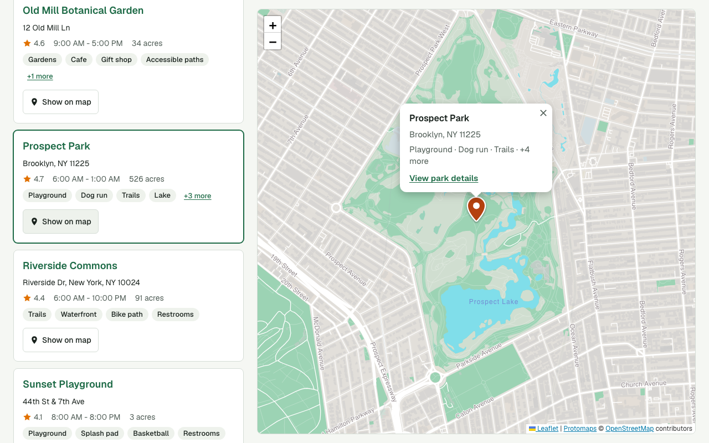
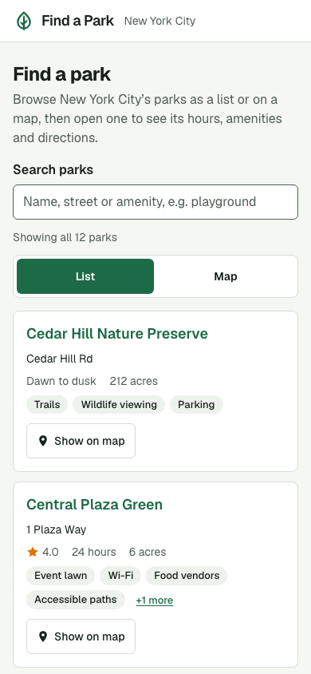
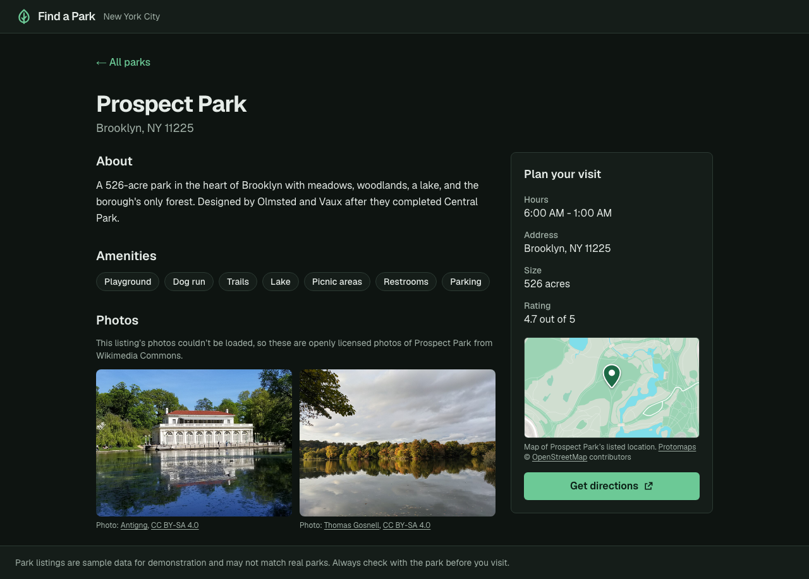
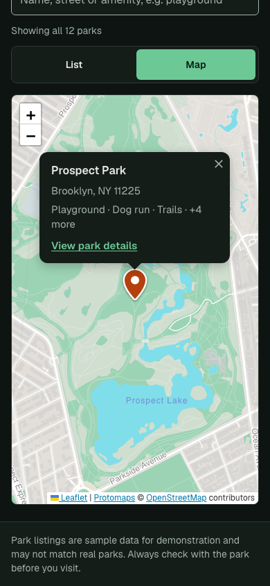

# Find a Park

A small web app that helps New York City residents find a park: browse a
list or a map, search, and open a park to see its hours, amenities, photos
and directions.

## Background

This is my submission for Granicus's "Find a Park" take-home exercise. The
full brief is in [docs/brief.md](docs/brief.md): build a small, accessible
park finder (map, list and details) from a supplied sample dataset, in about
two hours, with AI tools expected, and submit the code, this README and the
complete AI conversation logs.

I built it with Claude Code: I set up the project and directed the work,
Claude Code built the first version overnight (including independent
AI review passes), and I then reviewed it and asked for changes.
[docs/overnight-notes.md](docs/overnight-notes.md) is the handoff Claude
Code wrote at the end of that overnight run; the full transcripts are in
[`transcripts/`](transcripts/). See also [AI use](#ai-use) and
[Time spent](#time-spent).

| Desktop                                                               | Phone                                                             |
| --------------------------------------------------------------------- | ----------------------------------------------------------------- |
|   |     |
|  |  |

## Run it

Requirements: **Node 24** (pinned in `.nvmrc` and `.tool-versions`),
**pnpm 10** (`corepack enable` will provide it), and an internet connection
(the Geist font is downloaded from Google Fonts during `dev` and `build`). No
API keys or accounts are needed.

```bash
pnpm install                            # also installs a git pre-commit hook (Prettier)
pnpm dev                                # http://localhost:3000
```

Production: `pnpm build && pnpm start`. The app needs a Node server (`next
start` or a Node host); it isn't a static export, because unknown park URLs
are rendered on request to return a real 404.

The map's tiles are a file in the repo (`public/tiles/nyc.pmtiles`, see
[Important decisions](#important-decisions)), so there's no tile provider to
set up. Optional, read at **build** time: `NEXT_PUBLIC_MAP_PMTILES_URL` serves
that file from elsewhere, such as object storage; the host must support HTTP
range requests. `scripts/build-tiles.sh` regenerates it from the latest
OpenStreetMap data (it needs the `pmtiles` CLI: `brew install pmtiles`).

If CSS changes don't show up (in `pnpm dev` or a local build), Turbopack's
on-disk cache is serving a stale stylesheet; `pnpm clean` clears it. CI
always builds from scratch, so it isn't affected.

### Checks

```bash
pnpm check                              # types, lint, formatting, unit tests
pnpm exec playwright install chromium   # once, for the browser tests
pnpm test:e2e                           # end-to-end + accessibility, desktop and phone
```

`pnpm test:e2e` builds the app and serves it on port 3100 (`E2E_PORT` changes
it); locally it reuses a server already running on that port. CI
(`.github/workflows/ci.yml`) runs both on every push and pull request.

## What works

- **List** of all parks, alphabetical, with address, rating, hours, size and
  the first few amenities ("+3 more" expands the rest in place). Each park
  name links to its details page.
- **Map** (Leaflet, with self-hosted OpenStreetMap vector tiles) with a
  marker per park. Selecting a marker opens a summary with a link to the park's details, and highlights
  the park in the list. "Show on map" on a list card does the reverse, and
  on wide screens clicking a card centers its park on the map (keeping your
  zoom).
- **Park details** page for each park: description, amenities, photos,
  hours, address, size, rating and a "Get directions" link (Google Maps, no
  key needed). Every page has its own URL and title.
- **Location preview** on each park's details page: a small, still map with
  the park's pin, next to "Get directions".
- **Fallback photos for real parks.** When a park's listed photos are
  missing or all fail to load, and it's a real park I could verify, openly
  licensed photos from Wikimedia Commons are shown instead, credited and
  labeled as such (see [Data](#data)).
- **Search** by name, street or amenity (e.g. "dog run", "brooklyn
  playground"), filtering the list and the map together.
- **Phone and desktop layouts.** On phones the list comes first and the map
  is one tap away; the map's code and tiles aren't downloaded until then.
- **Keyboard and screen reader support** for every task, including the map
  (see [Accessibility](#accessibility)).
- **Missing or bad data** never crashes a page or gets filled in with guesses
  (see [Data](#data)).
- **Failures degrade gracefully:** broken photos become labeled
  placeholders; if map tiles can't load, a notice appears and markers still
  work; if the map can't load at all, the list still works; unknown park URLs
  return a real 404 page.
- Light and dark mode, following the device setting.

Works without the resident's location; the app never asks for it.

## What I left out

- **Current location / "parks near me"** and **amenity filters**: optional in
  the brief; search covers the most common need ("playground", "dog run").
- **"Open now"**: the hours are free text ("Dawn to dusk", "24 hours",
  "6:00 AM - 1:00 AM"); interpreting them reliably needs structured data and
  a time zone, so they're shown exactly as published instead.
- **Marker clustering**: with 12 parks it isn't needed (see Known issues).
- **Search state in the URL** (shareable searches), a backend, accounts and
  deployment.

## Important decisions

- **Next.js 16 (App Router) + TypeScript**, starting from the official
  `create-next-app` template rather than a third-party boilerplate. The home
  page and every park page are prerendered at build time from the JSON file;
  only unknown park URLs are rendered on request (to return a real 404).
- **Leaflet, with OpenStreetMap tiles.** No API key for the interviewer to
  supply, a small bundle, and markers that are keyboard-focusable out of the
  box. I compared MapLibre + OpenFreeMap (prettier vector map, but ~5x the
  code and no built-in marker accessibility), Mapbox and Google (both need
  keys and billing).
- **Self-hosted vector tiles** (changed after submission; the submitted
  version used OSM's public tile servers, which don't allow production
  traffic). `public/tiles/nyc.pmtiles` is a 29 MB
  [PMTiles](https://docs.protomaps.com/pmtiles/) archive of the five
  boroughs, cut from [Protomaps](https://protomaps.com)' OpenStreetMap
  builds and drawn in the browser by `protomaps-leaflet`, so markers,
  popups and keyboard support are unchanged. The browser fetches only the
  parts it needs, with HTTP range requests. The archive stops at zoom 14
  (zoom 15 would triple its size); closer zooms are drawn from it and stay
  sharp. The map can't be zoomed out past the city or panned far beyond it.
- **The list and details pages are the primary interface; the map is an
  enhancement.** Everything a marker does can also be done from the list,
  which is what makes the map optional for keyboard, screen reader and
  low-bandwidth users.
- **One normalization step at the edge.** `src/lib/parks/normalize.ts` turns
  the raw JSON into a `Park` type where every optional field is a real value
  or `null`/`[]`. UI code never re-checks the raw shape, and pages only talk
  to `getParks`/`getPark` in `src/lib/parks/data.ts`. Swapping in an API means
  changing that module and making those two functions (and their three
  callers) async.
- **Amenity order.** Restrooms and parking, which nearly every park has, are
  listed after a park's distinctive amenities, so the first chips on a card
  say what makes that park worth visiting (`LOW_PRIORITY_AMENITIES` in
  `src/lib/parks/amenities.ts`). The data's own amenities are unchanged.
- **Visit info first on the details page.** On phones, hours, address and
  directions come before the description and photos, because that's what
  most people opening a park page need.

## Data

The supplied `assets/parks.sample.json` is used unchanged (byte-identical).
I did not extend the schema.

How missing or invalid values are handled (`src/lib/parks/normalize.ts`):

| Situation                                                                    | What the app does                                                                                                                                             |
| ---------------------------------------------------------------------------- | ------------------------------------------------------------------------------------------------------------------------------------------------------------- |
| Missing/blank/non-text description, hours or address                         | Details page: "Not listed" / "No description available." List card: "Address not listed"; missing hours, size or rating are simply left out of the card       |
| Missing or invalid coordinates (incl. 0,0)                                   | Park stays in the list, which says it isn't on the map; the details page says directions aren't available                                                     |
| Empty or missing amenities / images                                          | "No amenities listed." / the Photos section is left out (unless a fallback applies)                                                                           |
| Amenity with no letters or digits (e.g. `"-"`)                               | Dropped                                                                                                                                                       |
| Image URL that isn't http(s), or fails to load                               | Dropped / replaced with a "Photo unavailable" tile; if _all_ fail (or none are listed) and the park is a verified real park, credited fallback photos instead |
| Rating that isn't a number from 0 to 5; acreage that isn't a positive number | Treated as missing                                                                                                                                            |
| Not an object, no name, no URL-safe id, or a duplicate id                    | Record skipped (it can't be shown or linked to)                                                                                                               |

Every skipped record or ignored value is logged at build time so data
problems are visible. Issues I noticed in the sample data:

- **Cedar Hill Nature Preserve's coordinates (40.7128, -74.006) are exactly
  the commonly used "New York City" point at City Hall**, which suggests a
  placeholder. I show it where the data says: the app has no way to know
  the real location, and warning residents based on my guess would be
  inventing details too. It should be fixed at the source.
- All image URLs point to `images.example.com`, which doesn't exist, so
  listed photos never load. Without a fallback, they show "Photo
  unavailable" placeholders.
- **Only Prospect Park is a real park.** The other eleven names don't match
  any real park, though many sit at real places (e.g. "Central Plaza Green"
  is at Bryant Park's coordinates). Showing a photo of Bryant Park as
  "Central Plaza Green" would be inventing details, so only Prospect Park
  has fallback photos.

**Fallback photos** (`src/lib/parks/fallback-photos.ts`) treat the data like
an external API: it is never changed. A park's listed photos always win; the
fallback is used only if the listing has no photos or every listed photo
fails to load. An entry only applies when both the park's id and name
match, so a reused id can't show the wrong park. Photos are CC BY-SA 4.0
from Wikimedia Commons, with the required credit under each. They're copied
into `public/photos/` (Commons' 960px versions) rather than linked, so
visitors don't load them from Wikimedia's servers (changed after
submission).

Broken photo links are never hidden: a listed photo that fails to load shows
as "Photo unavailable" (or, when a fallback is used, the note says the
listing's photos couldn't be loaded), and each failure is logged to the
browser console so bad URLs in the data get noticed.

- Several addresses are partial ("Ridge Rd", "1 Plaza Way"), so directions
  use coordinates instead of addresses.
- Ratings have no stated source or scale; I assume 0–5 and label them only
  as "Rating".

## Accessibility

Target: WCAG 2.2 AA.

- Skip link; landmarks and a logical heading order on every page; a
  consistent 3px focus outline on every control (on the map, a two-tone
  version so it shows on any tile).
- Every task works with a keyboard alone. Map markers are buttons with a
  descriptive name (e.g. "Prospect Park, Brooklyn, NY 11225. Show park
  summary."), open with Enter or Space, move focus into the popup, and
  Escape closes it and returns focus to where it came from. Leaflet doesn't
  do the last three on its own (`src/components/park-map.tsx`).
- After a page change, focus moves to the new page's heading; coming back
  to the list puts focus on the park you opened.
- The details page's location preview is decorative for assistive tech
  (hidden, not focusable): the address and directions link carry the same
  information, and a caption describes it.
- The map itself is a named group with keyboard instructions (arrow keys
  pan, +/- zoom).
- Search results are announced via a live region (once typing pauses); the
  List/Map toggle uses `aria-pressed`. The app's buttons and map markers are
  at least 44×44px; Leaflet's zoom buttons (30px on touch screens) and the
  popup close button (32px) meet WCAG 2.2's 24px minimum.
- Color contrast is at least 4.5:1 for text in both color schemes; motion is
  reduced when the device asks for it; pages reflow without horizontal
  scrolling down to 320px (about 400% zoom).

## How I checked it

**Automated** (all run in CI):

- 61 unit and component tests (Vitest + Testing Library): data
  normalization for every missing/invalid case, search, formatting, amenity
  ordering, when fallback photos may and may not appear, and park cards.
- 87 browser tests (Playwright) against a production build, each run on a
  desktop and a phone viewport except a few tagged for one layout:
  keyboard-only flows (list → details, markers with Enter/Space/Escape,
  skip link, focus after navigation), search, the 404
  page, missing data on the real sample parks, map tiles failing, the map
  code failing, and regression tests for each bug below. Map tiles come from
  the app itself and external photos are stubbed, so tests send no
  third-party traffic.
- axe-core WCAG 2.2 AA scans of 7 page states (list, open popup, no search
  results, full and sparse details, 404, and a selected park with the
  map-tiles-failed notice), in light and dark mode, plus reflow checks at
  320px.

**Manual**: I used the app in a browser at phone and desktop sizes, in both
color schemes, with mouse and keyboard only, and reviewed screenshots of each
screen (`pnpm screenshots` regenerates them).

**Independent review**: two separate AI review passes, each without any
context from the build, audited the code: one for accessibility (WCAG 2.2
AA), one for correctness against this brief. I verified each finding before
acting on it; two claims turned out to be wrong or already fixed.

**Problems the checks found** (each fixed and, where possible, covered by a
test):

1. **The map crashed after visiting a park and pressing Back.** Next.js 16
   keeps the previous page mounted but hidden (React `<Activity>`) and re-runs
   its effects on return; react-leaflet's `MapContainer` destroys the map in
   that cleanup but never recreates it. Fixed with a small
   `StableMapContainer` (`src/components/stable-map-container.tsx`), which
   also keeps your pan and zoom when you come back.
2. **Popup link contrast in dark mode was 3.5:1.** Leaflet's stylesheet
   overrode the link color. axe passed because it can't measure contrast over
   map tiles; I caught it reviewing screenshots.
3. **Screen readers read "Show on map : Prospect Park"** (with a stray
   pause) because the park name came from a visually hidden span; found by a
   failing Playwright test. Now an explicit `aria-label`.
4. **Keyboard focus didn't move into a popup the second time it opened**,
   because react-leaflet keeps popup content mounted after the first open.
5. **Escape didn't close popups** while focus was inside them (Leaflet only
   listens when the map itself is focused).
6. **Going Back replayed the last "Show on map"**, jumping the map away
   from where you left it: React re-runs effects when Next.js re-shows a
   hidden page. Requests are now handled exactly once.
7. **"Show on map" could leave the park off-center**: opening the popup
   during the pan animation stopped the pan. A trace of the map's transforms
   showed it; the popup now opens when the map arrives.
8. **Pins were drawn about 4px above their location**: Leaflet's stylesheet
   overrode the pin's positioning. Now tested to the pixel.
9. **Focus was stranded after navigating** (Next.js leaves it to the app):
   focus now moves to the new page's heading, and back to the park you opened
   when you return.
10. **The map's own focus ring was clipped, and invisible in dark mode** over
    the (always light) map tiles; the map now uses a two-tone ring.

### My review

My raw notes are in [`self-review-scratch.txt`](self-review-scratch.txt); this
is a tidied version. I checked, in this order: the running app, the tests,
`package.json`, the documentation, then the app code.

What I checked and found:

- **Accessibility testing.** `@axe-core/playwright` was new to me. It's what
  [Playwright's own docs recommend](https://playwright.dev/docs/accessibility-testing),
  it's widely used (about 14 million weekly downloads, 700+ GitHub stars), and
  I like the ethos in its README.
- **Do the tests catch regressions?** I sanity-checked by removing the park
  list's `role` and its label. Without `role="list"` the tests still pass,
  which is fine since a `<ul>` is already a list; without the label they
  fail, as they should.
- **Skipped tests.** The suite reported skipped tests, which normalizes
  skips even when they aren't needed. They're now selected per layout by tag
  instead, and that turned up a phone path that wasn't tested at all.
- **Keyboard navigation** works really well.
- **Photo attribution**: spot-checked the fallback photos' credits.
- **Reduced motion**: I like the media-query approach, but didn't have time to
  test it myself.

What I'd do differently in a production app:

- **Icons**: use an explicitly open-source icon set. Hand-drawn SVGs are too
  big a risk of ending up byte-identical to someone else's IP.
- **Validation**: Zod rather than hand-written normalization, for an app
  that's expected to be extended.

## Known issues

- At the zoomed-out city view on a phone, a few nearby markers overlap. Each
  marker is a 44×44px target, and every marker action is also available from
  the list (WCAG 2.5.8's "equivalent control" exception), so the overlap is
  accepted in the accessibility tests for markers only.
- If a park's popup was open when you left, that park is still highlighted
  (and focused) when you come Back. I kept this as a "you were here" cue, but
  it's a judgment call worth testing with residents.
- Leaflet's zoom buttons come after the markers in Tab order. The list is the
  primary keyboard path, so I didn't fight Leaflet's DOM order.
- Only tested in Chromium (at desktop and phone sizes). Screen reader output
  was checked through the accessibility tree, not with VoiceOver or NVDA.
- The map only covers the five boroughs, and its data is as current as the
  last `scripts/build-tiles.sh` run.
- The map background is always light, including in dark mode (Protomaps
  also has a dark style; untested here).
- The Geist font is fetched from Google Fonts at build time, so
  `pnpm build` needs internet access.
- If Next.js discards the hidden home page after many navigations, the Leaflet
  map behind it is never explicitly destroyed; it holds no global listeners,
  so it should simply be garbage-collected (see the comment in
  `stable-map-container.tsx`).

## Time spent

About 30 minutes creating, about 90 minutes validating and finding small but
impactful refinements with some submission preparation mixed in.

Agent time closer to 3 hours as I let it run unattended a couple of times.

## Next steps before public use

1. **Real data source and ownership**: an API or CMS the parks department
   maintains, validation at import time (the normalizer's warnings are a
   start), real photos with proper alt text, and a stated rating source.
2. **Usability testing with residents**, including screen reader users
   (VoiceOver, NVDA) and people on low-end phones — automated checks don't
   replace this.
3. **Hosting and operations**: deploy to a Node host (or Vercel) behind a
   CDN, error monitoring (the error boundaries already log), uptime checks,
   and a privacy-friendly analytics decision.
4. **Content and language**: plain-language review, translations for the
   city's main languages, and "Open now" once hours are structured.
5. **Security**: headers (a CSP allowing only the listings' image hosts) and a
   security review; an AI-assisted pass is cheap enough to always run.
6. **Review by real stakeholders** before launch, alongside the resident
   testing above.
7. **Knowledge transfer**: if this is handed to a client's engineers or
   another team, walk the maintainers through it and answer their questions.

## Project layout

```
assets/parks.sample.json        supplied data (unchanged)
src/lib/parks/                  normalize, search, format, data loading (+ tests)
src/lib/parks/amenities.ts      amenity labels and display order
src/lib/parks/fallback-photos.ts  credited photos for real parks, used only as a fallback
src/app/page.tsx                home: list + map
src/app/parks/[id]/page.tsx     park details (prerendered per park)
src/components/park-explorer.tsx  search, List/Map toggle, shared selection
src/components/park-list.tsx    park cards
src/components/park-map.tsx     Leaflet map, accessible markers and popups
src/components/stable-map-container.tsx  Leaflet map that survives navigation
src/components/render-when-visible.tsx   defers the map until it's shown
src/components/map-error-boundary.tsx    keeps the list working if the map fails
src/components/park-photos.tsx  listed photos, placeholders, and the fallback-photo rule
src/components/park-location-map.tsx  still location preview on the details page
src/components/route-focus.tsx  focus management after navigation
src/app/not-found.tsx, error.tsx, global-error.tsx  404 and error pages
src/components/vector-tile-layer.tsx    the map background, from the tile archive
public/tiles/nyc.pmtiles        self-hosted map tiles for the five boroughs
public/photos/                  self-hosted fallback photos (credited in fallback-photos.ts)
e2e/                            Playwright tests (incl. accessibility, regressions)
scripts/build-tiles.sh          regenerates public/tiles/nyc.pmtiles
scripts/screenshots.spec.ts     regenerates docs/screenshots
docs/brief.md                   the take-home brief (verbatim, as Markdown)
docs/overnight-notes.md         Claude Code's handoff notes from the overnight build
self-review-scratch.txt         my raw review notes (tidied in "My review")
transcripts/                    full, unredacted AI conversation logs
transcripts/human-readable/     the same session as a browsable HTML page
```

## AI use

I used Claude Code rather than Copilot, my usual daily driver at work, and
some of the transcript shows me riding that gentle learning curve.

The complete, unredacted logs are in [`transcripts/`](transcripts/) (see its
[README](transcripts/README.md)). For easier reading,
[`transcripts/human-readable/`](transcripts/human-readable/) has the same
session as one HTML page, with a button to show only my own prompts.
