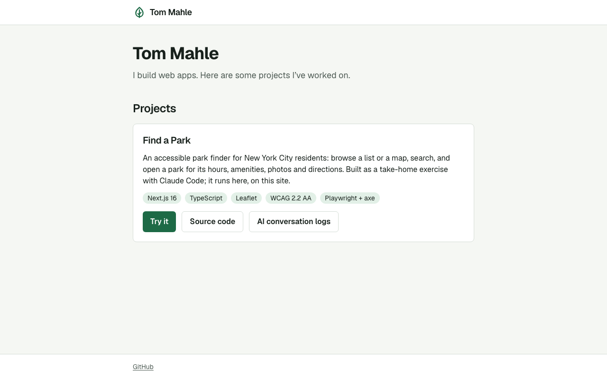

# tommahle.com

My portfolio site: a short intro and the projects I've built, with
[Find a Park](#find-a-park) running live at `/find-a-park`.

This repo started as a copy of
[TomMahle/find-a-park](https://github.com/TomMahle/find-a-park), my take-home
submission, and keeps its history. It reuses that project's setup (Next.js,
Tailwind, accessibility tests, CI) for the whole site.

| Portfolio                                                            | Find a Park                                                         |
| -------------------------------------------------------------------- | ------------------------------------------------------------------- |
|  |  |

## Run it

Requirements: **Node 24** (pinned in `.nvmrc` and `.tool-versions`) and
**pnpm 10** (`corepack enable` will provide it). The Geist font is downloaded
from Google Fonts during `dev` and `build`, so those need internet access.

```bash
pnpm install                            # also installs a git pre-commit hook (Prettier)
pnpm dev                                # http://localhost:3000
```

Production: `pnpm build && pnpm start`. It needs a Node host (Vercel works),
not a static export, because unknown park URLs return a real 404.

### Checks

```bash
pnpm check                              # types, lint, formatting, unit tests
pnpm exec playwright install chromium   # once, for the browser tests
pnpm test:e2e                           # end-to-end + accessibility, desktop and phone
pnpm screenshots                        # regenerates docs/screenshots
```

CI (`.github/workflows/ci.yml`) runs the checks and browser tests on every
push and pull request.

## Adding a project

Add an entry to `src/content/projects.ts`. Its first link is the main
button; links can be paths on this site or full `https://` URLs.

## Find a Park

An accessible park finder for New York City, at `/find-a-park`. Its full
write-up (decisions, data handling, accessibility, the AI conversation logs)
is in the [find-a-park README](https://github.com/TomMahle/find-a-park#readme).
Since the copy, it lives here:

- Routes: `src/app/find-a-park/` (paths built by `src/lib/parks/routes.ts`)
- Code: `src/components/park-*`, `src/lib/parks/`, data in `assets/`
- Map tiles: `public/tiles/nyc.pmtiles`, self-hosted vector tiles of the five
  boroughs; `scripts/build-tiles.sh` rebuilds them (needs
  `brew install pmtiles`)
- Fallback photos: `public/photos/`, credited in
  `src/lib/parks/fallback-photos.ts`

## Project layout

```
src/app/page.tsx                portfolio home page
src/app/layout.tsx              site header (leaf icon) and footer
src/app/icon.svg, favicon.ico, apple-icon.png   site icons
src/content/projects.ts         the projects listed on the home page
src/components/project-card.tsx a project on the home page
src/app/find-a-park/            Find a Park: layout, list + map, park pages, 404
e2e/                            Playwright tests (portfolio, Find a Park, accessibility)
scripts/screenshots.spec.ts     regenerates docs/screenshots
```
